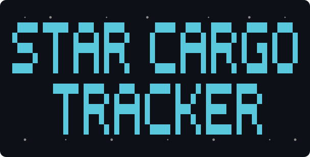
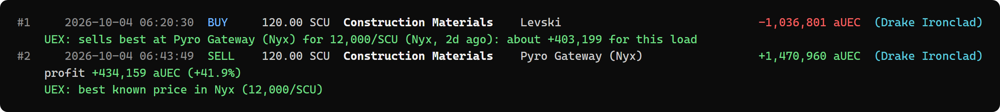
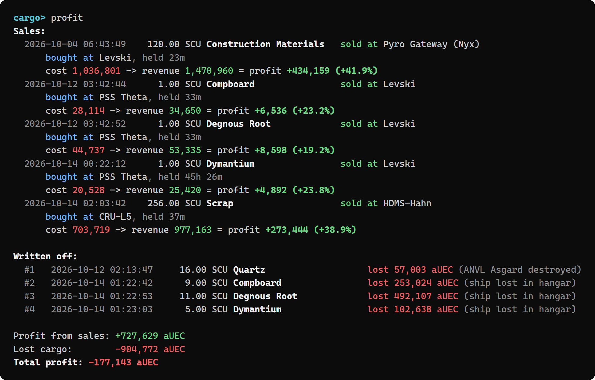
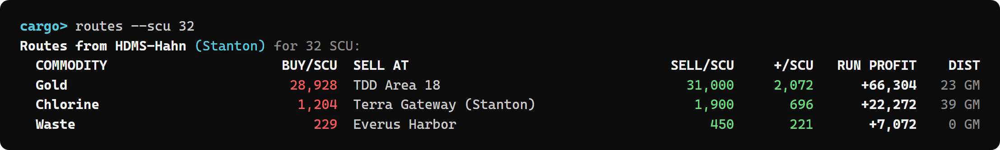
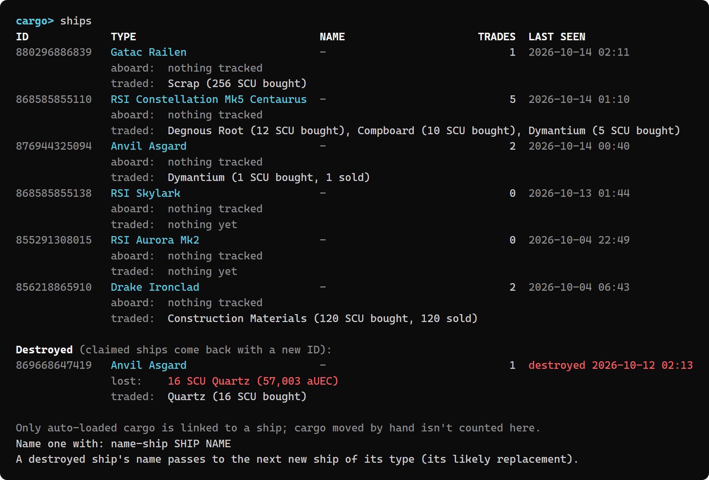

<p align="center">
  
</p>

A command-line tool for Windows and Linux, written in Rust, that tracks your **Star Citizen** commodity trading automatically. It reads the game's log file as you play and records every purchase and sale. It works out profit per run, tracks which ship your cargo is on, writes off cargo lost when a ship is destroyed, and can show it all in an overlay on top of the game.

There's no typing in numbers and no screenshots: buy and sell at commodity terminals as usual and the tracker picks it up.



> **Safe to use:** the tracker only *reads* `Game.log`, the plain-text log the game writes for itself. It never touches the game's memory or files, and never sends anything to the game, so there's nothing for Easy Anti-Cheat to object to.

---

## Features

**Automatic trade tracking**
- Records every commodity buy and sell from `Game.log`, live as you play.
- Separates trades that failed in the game (`CargoCreationFailed`, `InsufficentFunds`...) from completed ones.
- Knows **where** each trade happened (Levski, Port Tressler, Pyro Gateway (Nyx)...).
- Knows **which ship** auto-loaded cargo went into, and names your ships by type (Anvil Asgard, Drake Ironclad...).
- Shows commodity names, looked up once from the [Star Citizen Wiki API](https://api.star-citizen.wiki) and saved.

**Profit**
- Matches each sale to the purchases it came from (oldest cargo first, same ship first) to work out profit and margin per sale.
- Lists cargo you've bought but not sold yet.
- **Ship destroyed with you aboard?** The cargo on it is written off as a loss automatically. A claimed ship comes back with a new ID, and the name you gave the old one passes to it.
- Record other losses by hand with `write-off`, and `cancel-trade` any sale that never paid out.
- `export` saves everything to an Excel workbook: a summary, every trade, sales with their profit, write-offs, unsold cargo and ships, each on its own sheet with filters.

**Market data from [UEX](https://uexcorp.space)**
- After a **purchase**: where that commodity sells best, and roughly what this load would make.
- After a **sale**: whether you got the best known price nearby, or how much you left on the table.
- `prices`: where to buy any commodity cheapest and sell it best.
- `routes`: the most profitable runs from where you are, sized to your ship's cargo space.
- An estimated value for unsold cargo in `profit`.

**Your UEX account**
- Sends every completed trade to your UEX wallet and trade history, automatically.
- Test mode first; cancelled trades are reversed; nothing is ever sent twice.

**Overlay**
- A small transparent overlay in the top-right of the game's screen shows a status line and each trade as it happens (with profit and UEX tips), fading after 10 seconds.
- Clicks pass straight through it, it never takes focus, and it follows the game to whichever monitor it's on.
- Uses [Share Tech Mono](https://fonts.google.com/specimen/Share+Tech+Mono) for a HUD look.

**Interactive prompt**
- While tracking, a `cargo>` prompt runs any command without stopping the tracker.
- Tab completion for commands, trade IDs, ships, commodities and locations, plus Up/Down command history.
- Colour-coded output (switched off automatically when output goes to a file).

---

## Requirements

- **Windows 10 or 11**, or **Linux** (x86-64) with the game running under Wine or Proton; see [Linux](#linux).
- **Star Citizen**. For the overlay to show over the game, set **Graphics → Window Mode** to **Borderless**: an exclusive-fullscreen game can't have windows drawn over it.
- To build from source:
  - [Rust](https://rustup.rs) (stable, 1.82 or newer) with the MSVC toolchain.
  - **Visual Studio Build Tools** with the *Desktop development with C++* workload (Rust's linker, and to build the bundled SQLite).

Internet access is optional: it's only used for commodity names and UEX market data, both of which are cached. Without it, everything else works as normal.

## Building

```powershell
git clone <this repository>
cd starCargoTracker
cargo build --release
```

The program is then `target\release\star-cargo-tracker.exe`. You can copy it anywhere; the font is built into it.

During development, `cargo run -- <command>` builds and runs in one step, and `cargo test` runs the tests.

### Getting a UEX app token

The program doesn't come with a UEX app token, so you'll need your own to **send your trades to your UEX account** (`uex sync`, see [Syncing with your UEX account](#syncing-with-your-uex-account)). UEX won't accept entries without one. Market data (`prices`, `routes`, `terminals` and the tips after each trade) works without a token.

Tokens are free:

1. **Sign in to [UEX](https://uexcorp.space)**, or create an account. UEX signs you in with Discord.
2. **Open [My Apps](https://uexcorp.space/api/apps)** at `uexcorp.space/api/apps`. It isn't linked from your profile; you can also reach it from *My Apps* under *API 2.0* on the [API documentation](https://uexcorp.space/api/documentation/) page.
3. **Create an app.** Any name works, e.g. `Star Cargo Tracker`. Leave **Client Version Lock** off: with it on, the token only works with the exact program versions you list, so it would stop working when you update.
4. **Copy the app's token.**
5. **Save it in the tracker**, at the `cargo>` prompt or in a terminal:
   ```powershell
   star-cargo-tracker uex token YOUR_TOKEN
   ```
   Or set the `STAR_CARGO_UEX_TOKEN` environment variable instead. Run `uex` to check: it should show **App token: set**.

Keep the token to yourself. It's tied to your UEX account, and UEX limits how many requests each token can make.

## Quick start

1. **Start tracking** before or after launching the game:
   ```powershell
   star-cargo-tracker
   ```
   It finds your Star Citizen install by itself, or asks for it once; see [Game log location](#game-log-location).
2. **Trade in game.** Each trade appears in the terminal (and on the overlay, if it's on).
3. At the `cargo>` prompt, try `profit`, `history`, `ships` or `routes`.
4. **Load your earlier sessions** once with `import`, which reads the game's `logbackups` folder.
5. Type `overlay on` to show the overlay, and `exit` (or press Ctrl+C) to stop.

## Linux

Each release also has a Linux build for x86-64, `star-cargo-tracker-linux-x86_64.tar.gz`. It's built and tested on Ubuntu 22.04, so it should run on Ubuntu, Debian and their derivatives from around that age onwards. It may well work on other distributions too: it has been run on Arch, for example.

```bash
tar -xzf star-cargo-tracker-linux-x86_64.tar.gz
cd star-cargo-tracker
./star-cargo-tracker
```

Everything works as on Windows, with these differences:

- **Finding the game.** Star Citizen runs under Wine, so the tracker looks inside Wine prefixes: `$WINEPREFIX`, `~/Games/star-citizen` (the [LUG Helper](https://github.com/starcitizen-lug/lug-helper)'s default), other folders in `~/Games` (e.g. Lutris), `~/.wine`, and Steam's Proton prefixes. If yours is elsewhere, point it at the install, e.g. `game-folder "~/Games/star-citizen/drive_c/Program Files/Roberts Space Industries"`.
- **Your data** is kept in `~/.local/share/star-cargo-tracker/trades.db` (or under `$XDG_DATA_HOME`), and `export` saves to your Documents folder.
- **The overlay is best-effort.** It opens as a small transparent window in the top-right corner. On X11 that usually works over a borderless game. On Wayland, apps can't choose where their windows go or keep themselves above a fullscreen game, so it may appear elsewhere or behind the game. Everything else works without it.

### Building on Linux

1. Install [Rust](https://rustup.rs) (stable).
2. Install a C compiler and the libraries the overlay builds against. On Ubuntu or Debian, which the release builds use:
   ```bash
   sudo apt install build-essential pkg-config libxkbcommon-dev libwayland-dev \
     libxcb-render0-dev libxcb-shape0-dev libxcb-xfixes0-dev libgl1-mesa-dev
   ```
   On other distributions, install the equivalent packages. On Arch, for example:
   ```bash
   sudo pacman -S --needed base-devel libxkbcommon wayland libxcb mesa
   ```
3. Build it:
   ```bash
   git clone https://github.com/tactilebiscuit4/StarCargoTracker.git
   cd StarCargoTracker
   cargo build --release
   ```
   The program is then `target/release/star-cargo-tracker`.

## Commands

Run any of these as `star-cargo-tracker <command>`, or type them at the `cargo>` prompt while tracking. `help` lists them all.

### Tracking
| Command | What it does |
|---|---|
| `watch [GAME_LOG]` | Follow `Game.log` and record trades live, with the `cargo>` prompt. The default with no command. |
| `overlay [GAME_LOG]` | Like `watch`, with the overlay shown. At the prompt: `overlay on`, `overlay off`, or `overlay` to switch. |
| `import [PATH...]` | Record trades from log files or folders. With no path, imports the game's `logbackups` folder. Safe to repeat. |
| `game-folder [PATH]` | Show where Star Citizen is installed, or set it. Found automatically the first time; see [Game log location](#game-log-location). |

### Trades and profit
| Command | What it does |
|---|---|
| `history [COUNT] [--failed]` | Recent trades and overall totals. Failed trades are hidden unless `--failed`. |
| `profit` | Profit per sale, write-offs, unsold cargo (with estimated value) and total profit. |
| `export [PATH]` | Save everything to an Excel workbook (`.xlsx`). With no PATH it goes in your Documents folder as `Star Cargo Tracker YYYY-MM-DD.xlsx`; PATH can be a file or a folder. Times are in your time zone. |
| `cancel-trade ID` | Stop counting a trade that didn't really happen, e.g. a sale whose cargo never went down the freight elevator. |
| `restore-trade ID` | Count a cancelled trade again. |
| `write-off COMMODITY SCU\|all [NOTE]` | Record cargo you lost. Partial names work: `write-off sil 40 jettisoned`. |
| `delete-write-off ID` | Undo a write-off. |

### Market (UEX data)
| Command | What it does |
|---|---|
| `prices COMMODITY` | The 10 cheapest places to buy it and the 10 best places to sell it, with stock and how old each price is. |
| `routes [FROM] [--scu N]` | The most profitable runs from where you are (or `FROM`), for your ship's cargo space (or `N` SCU). |
| `terminals [SEARCH]` | Which UEX terminal each of your trade locations matched, or search UEX's terminals. |
| `link-terminal CODE ID` | Tie a location code to a UEX terminal by hand, when it isn't matched automatically. |

### UEX account
Sends each completed trade to your [UEX](https://uexcorp.space) account: a **wallet** entry (a debit for a buy, a credit for a sale) and a **trade history** entry (terminal, commodity, SCU, price per SCU). See [Syncing with your UEX account](#syncing-with-your-uex-account).

| Command | What it does |
|---|---|
| `uex` | Syncing status, how many trades have been sent, and your UEX wallet balance. |
| `uex secret KEY` | Save your UEX secret key (from your UEX profile). |
| `uex token TOKEN` | Save your UEX app token (make an app at [uexcorp.space/api/apps](https://uexcorp.space/api/apps)). |
| `uex sync on\|off` | Send new completed trades (from when your secret key was added). Starts in test mode. |
| `uex send-past` | Also send trades from before then. They'll all be dated when they're sent; asks you to confirm with `uex send-past yes`. |
| `uex live` / `uex test` | Real entries, or UEX's test mode (nothing real is recorded). |
| `uex wallet on\|off`, `uex history on\|off` | Choose where trades are sent. |
| `uex push` | Send anything waiting now, retrying entries UEX rejected. |
| `uex forget` | Remove your saved key and token, and stop syncing. |

### Ships and locations
| Command | What it does |
|---|---|
| `ships` | Your ships, the cargo aboard each, what each has traded, and destroyed ships at the bottom. |
| `name-ship SHIP NAME` | Name a ship. `SHIP` can be its ID, the end of its ID, or part of its type: `name-ship asgard "Big Bertha"`. |
| `locations [--failed]` | The location codes from your trades, the names shown for them, and how many trades completed there. `--failed` adds a column for trades that failed in the game. |
| `name-location CODE NAME` | Name a location the tracker doesn't recognise: `name-location AsteroidClusterBase_Nyx_Social_Keeger_003 "PSS Theta"`. |

IDs like `#12` are shown by `history` (trades), `profit` (write-offs) and `ships`. Put names with spaces in double quotes.

## Examples

**`profit`**: each sale with what the cargo cost and earned, cargo written off, and the totals.



**`routes --scu 32`**: the best place to sell each commodity you can buy where you are, using UEX prices.



**`ships`**: each ship you've used, what's aboard and what it has traded, with destroyed ships listed separately.



## Configuration

### Game log location
The game writes its log to `StarCitizen\LIVE\Game.log` inside the folder you chose in the RSI Launcher, e.g. `C:\Program Files\Roberts Space Industries\StarCitizen\LIVE\Game.log`. You don't need to tell the tracker; the first time it runs it:

1. Looks where the RSI Launcher was told to install games (the launcher notes this in its own log).
2. Otherwise checks the usual places on every drive: `Roberts Space Industries`, `Program Files\Roberts Space Industries` and `Games\Roberts Space Industries`.
3. Otherwise asks you for the install folder. Any level works: the folder you chose in the launcher, the `StarCitizen` folder, the `LIVE` folder, or `Game.log` itself.

The folder it finds is remembered. `game-folder` shows it, and `game-folder PATH` changes it. Passing a path to `watch` or `overlay` overrides it for that run. The `LIVE` channel is always used; to track the PTU instead, point `game-folder` at its folder.

Each time the game starts, it moves the previous `Game.log` into the `logbackups` folder next to it; the tracker notices and carries on with the new log, and `import` reads `logbackups` for earlier sessions.

### Syncing with your UEX account
1. On [uexcorp.space](https://uexcorp.space), copy your **secret key** from your profile. UEX only accepts entries from accounts verified with their RSI handle.
2. Save it with `uex secret KEY`. Your secret key is yours alone: it's what writes to *your* wallet, so never share it.
3. Get an app token and save it with `uex token TOKEN`: see [Getting a UEX app token](#getting-a-uex-app-token). UEX requires one to accept entries.

Both are kept in your local database, never in the project folder; or set `STAR_CARGO_UEX_SECRET` and `STAR_CARGO_UEX_TOKEN` instead.
4. `uex sync on` starts in **test mode**: UEX checks every entry but records nothing. Check `uex` shows no rejections.
5. `uex live` sends real entries. Anything sent in test mode is sent again for real.

Only trades made **after** you add your secret key are sent. To also send earlier ones, use `uex send-past`: UEX's API has no way to say when a trade happened, so they'll all show as happening at the moment they're sent (in the right order). To remove them later, delete them by hand on the UEX site. `uex forget` clears the start point, so a key added later starts from then.

While tracking, new trades are sent within moments, in small batches that stay well inside UEX's limits. What's been sent is recorded per trade, so nothing is ever sent twice. Failed trades are never sent. `cancel-trade` adds a reversing wallet entry (UEX's API can't delete wallet entries; you can remove both by hand on the UEX site if you prefer) and removes the trade-history entry; `restore-trade` sends them again. Without internet, entries wait and go out later.

If UEX turns out to update your wallet from trade-history entries too, use `uex wallet off` so nothing is counted twice.

### Environment variables
| Variable | Purpose |
|---|---|
| `STAR_CARGO_DB` | Where to keep the database. Default: `%APPDATA%\star-cargo-tracker\trades.db` on Windows, `~/.local/share/star-cargo-tracker/trades.db` on Linux. |
| `STAR_CARGO_UEX_TOKEN` | UEX app token ([uexcorp.space/api/apps](https://uexcorp.space/api/apps)), instead of saving one with `uex token`. |
| `STAR_CARGO_UEX_SECRET` | Your UEX secret key, as an alternative to `uex secret`. |
| `STAR_CARGO_UEX_URL` | UEX API address, if it changes (must be `https://`). Default: `https://api.uexcorp.uk/2.0`. |
| `NO_COLOR` | Set to anything to turn colours off. |

## How it works

Star Citizen writes a detailed `Game.log` while it runs. The lines the tracker uses:

| Log line | Tells the tracker |
|---|---|
| `SendCommodityBuyRequest` / `SendCommoditySellRequest` | A trade: commodity, SCU, total price, terminal. |
| `CommodityTransactionResponse Error` | That trade failed, and why. Successful trades log nothing, so a trade counts as completed if no error follows within 5 seconds. |
| `RequestLocationInventory ... Location[...]` | Where you are, e.g. `RR_ARC_LEO` (Baijini Point). |
| `VehicleCargoDataRequest ... vehicleEntityId[...]` | Which ship the terminal is loading. |
| `releasing control token for 'ANVL_Asgard_...'` | One of your ships and its type, logged when you leave the pilot seat. |
| `ejected from zone ... destroyed vehicle` | The ship you were in was destroyed. |

Everything is stored in a local SQLite database, and re-reading a log never records anything twice.

### Project layout
| File | Purpose |
|---|---|
| `src/main.rs` | Commands and their output |
| `src/parser.rs` | Reads `Game.log` lines into events |
| `src/tracker.rs` | Confirms or fails trades; follows location, ship and losses |
| `src/watcher.rs` | Follows `Game.log` as it grows |
| `src/game.rs` | Finds the Star Citizen install and its logs |
| `src/live.rs` | The tracking loop shared by `watch` and `overlay` |
| `src/db.rs` | SQLite storage |
| `src/profit.rs` | Matches sales to purchases; profit and losses |
| `src/export.rs` | The Excel export |
| `src/uex.rs` | UEX market data and its cache |
| `src/uex_sync.rs` | Sending trades to your UEX wallet and trade history |
| `src/overlay.rs` | The on-screen overlay |
| `src/shell.rs` | The `cargo>` prompt and Tab completion |
| `src/names.rs`, `locations.rs`, `ships.rs` | Readable names for commodities, places and ships |
| `src/banner.rs`, `color.rs`, `format.rs` | Banner, terminal colours and number formatting |

## Limitations

- **Only what the log shows.** Auto-load fees, loading times and when freight-elevator sales actually pay out aren't logged. A sale is recorded when you place the order at the terminal; use `cancel-trade` if one never goes through.
- **Ships are only linked to auto-loaded cargo.** Cargo moved by hand isn't tied to a ship.
- **Ship destruction is only detected if you were aboard.** For other losses, use `write-off`.
- **Some locations need a name.** Asteroid stations and other places appear as raw codes until you `name-location` them.
- **UEX data is crowd-sourced** and can be out of date; every price shows its age.
- **Game updates can change the log format.** If trades stop appearing after a patch, the patterns in `src/parser.rs` probably need updating.

## Credits

- Market data: [UEX Corp](https://uexcorp.space), a community-run Star Citizen trading database.
- Commodity names: the [Star Citizen Wiki API](https://api.star-citizen.wiki).
- Overlay font: [Share Tech Mono](https://fonts.google.com/specimen/Share+Tech+Mono) by Carrois Type Design, used under the SIL Open Font License 1.1 (see `assets/fonts/ShareTechMono-OFL.txt`).
- Built with [egui/eframe](https://github.com/emilk/egui), [rusqlite](https://github.com/rusqlite/rusqlite), [rustyline](https://github.com/kkawakam/rustyline), [ureq](https://github.com/algesten/ureq), [rust_xlsxwriter](https://github.com/jmcnamara/rust_xlsxwriter) and other excellent Rust crates.

## Disclaimer

This is an unofficial fan project, not affiliated with or endorsed by Cloud Imperium Games. Star Citizen®, Roberts Space Industries® and Cloud Imperium® are trademarks of Cloud Imperium Rights LLC.

## License

Released under the [MIT License](LICENSE). The bundled Share Tech Mono font keeps its own license, the SIL Open Font License 1.1 (`assets/fonts/ShareTechMono-OFL.txt`).
